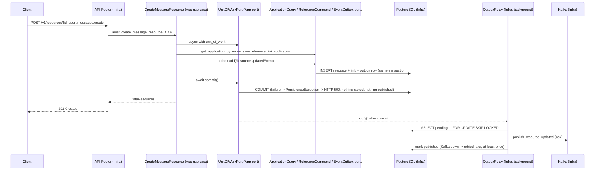

# Project Review: Resources Orchestrator

## 1. Overview
The **Resources Orchestrator** is a specialized service designed to manage and orchestrate resources used in **Retrieval-Augmented Generation (RAG)** workflows. Its primary purpose is to provide a centralized API to create, update, and review various types of data resources (Message queues, Database schemas, or REST endpoints). 

Once a resource is registered or updated, the system notifies other microservices and Model Context Protocols (MCPs) asynchronously via **Kafka**, ensuring that the orchestration of knowledge/context across the ecosystem remains synchronized.

## 2. Technologies & Design Patterns

### Technologies
*   **Language:** Python 3.14 (as per environment).
*   **Framework:** [FastAPI](https://fastapi.tiangolo.com/) for the REST API layer.
*   **Asynchronous Communication:** [Kafka-python](https://github.com/dpereira/kafka-python) for event-driven updates.
*   **Persistence:** PostgreSQL 16 with the [pgvector](https://github.com/pgvector/pgvector) extension (image `pgvector/pgvector:pg16`), managed via SQLAlchemy/Repository pattern.
*   **Data Validation:** [Pydantic](https://docs.pydantic.dev/) for Domain Models, DTOs, and API schemas.
*   **Dependency Management:** [UV](https://github.com/astral-sh/uv) for project and environment management.
*   **Testing:** [Testcontainers](https://testcontainers.com/) for integration testing with real Dockerized instances of Kafka and PostgreSQL.

### Design Patterns & Architecture
*   **Hexagonal Architecture (Ports and Adapters):** The project strictly separates the **Domain** (core logic) from **Infrastructure** (external tools) and **Application** (orchestration).
    *   **Domain:** Pure business logic, entities, and definitions.
    *   **Application:** Use cases (Services) that orchestrate domain logic using defined **Ports**.
    *   **Infrastructure:** Concrete implementations of ports (Adapters) for DB, Messaging, and Web.
*   **Dependency Injection (DI):** Constructor injection of ports into the application services; the wiring lives in a single composition root (`infrastructure/bootstrap`) built on FastAPI's `Depends`. Application-scoped resources (DB pool, Kafka producer/consumer) are created once in the lifespan and stored in `app.state`.
*   **Repository Pattern:** Used in the persistence layer to abstract database operations from the application logic.
*   **Adapter Pattern:** Implemented to translate between different protocols (e.g., HTTP to Application Service, or Kafka messages to Domain events).
*   **DTO (Data Transfer Object):** Used to decouple the API contract from the internal Domain Models, preventing leaking of infrastructure details.

## 3. Project Structure

```text
.
├── pyproject.toml          # Project metadata and dependencies
├── uv.lock                 # Locked dependency versions
├── src/
│   ├── main.py             # Entry point: app = create_app() (see infrastructure/bootstrap)
│   └── resources_orchester/
│       ├── application/     # Orchestration Layer
│       │   ├── ports/
│       │   │   ├── inbound/   # Driving ports: use cases offered to the outside (ResourcePortIn)
│       │   │   └── outbound/  # Driven ports the use cases need (queries, commands, event publisher)
│       │   └── use_cases/   # One class per use case (CreateMessageResource, SearchResources, ApplyResourceUpdate, drafts)
│       ├── domain/          # Core Business Layer
│       │   ├── api_dtos/    # Data Transfer Objects for API communication
│       │   ├── enum/        # Domain-specific enumerations
│       │   ├── exception/   # Domain-specific exceptions
│       │   └── model/       # Core Business Entities (Pydantic)
│       └── infrastructure/  # Implementation Layer
│           ├── bootstrap/   # Composition root: settings, app factory, lifespan, DI providers
│           ├── api_router/  # REST Controller (FastAPI Routers)
│           ├── messaging/    # Kafka Adapters and Workers
│           └── persistence/  # Database Adapters, Entities, and Repositories
└── test/
    ├── application/        # Unit & Integration tests for Use Cases
    └── infraestructure/     # Integration tests using Testcontainers (Real DB/Kafka)
```

## 4. Detailed Block Analysis

### 4.1. Domain Layer
The heart of the system. It contains the pure business rules and entities. It has no dependencies on any external library other than Pydantic for validation.

**Main Entities:**
*   **`DataResources`**: Represents a collection of data fields and their metadata.
*   **`ContextResource`**: Represents structured context (e.g., from Markdown files).
*   **`DataFieldResource`**: Granular metadata for a specific attribute (name, type, description, validations).

### 4.2. Application Layer
Contains the **Use Cases** (Services). It defines **Ports** (Interfaces) that the domain requires to complete a task.

**Core Logic (Sequence Diagram):**
The following diagram describes the flow of the `create_message_resource` use case:



### 4.3. Infrastructure Layer
Handles all external communications.
*   **API Router:** The REST controller. It receives HTTP requests, validates them via DTOs, and calls the Application Service.
*   **Messaging:** A Kafka-based implementation. It includes workers to consume updates and producers to notify the rest of the system.
*   **Persistence:** An implementation of the Repository pattern for PostgreSQL, mapping Domain models to Database Entities.

### 4.4. Testing Strategy
The project follows a "Real Integration" approach:
*   Instead of mocking the Database or Kafka, the `test/infraestructure` suite uses **Testcontainers**.
*   This ensures that the actual SQL queries and Kafka topic interactions are validated against real running instances, significantly reducing "it works in tests but not in prod" issues.
*   Run the suite from the project root with `uv run pytest` (a running Docker daemon is required). CI runs the same command on every push and pull request (`.github/workflows/tests.yml`).
*   Static checks (also in CI, configured in `pyproject.toml`): `uv run lint-imports` enforces the hexagonal dependency rules (infrastructure → application → domain, no frameworks in domain/application, no `src.` imports) and `uv run mypy` type-checks the package, including that every adapter matches the port it implements.
```
## 5. Resource Search

`GET /v1/resources/search?name=<fragment>&type=<ASYNC_MESSAGE|DB_TABLE|REST_OBJ>` returns the persisted
resources whose name contains `name` (case-insensitive partial match; `%` and `_` are matched literally),
optionally filtered by `type`. It always returns a list (`[]` when nothing matches).

The flow follows the same hexagonal layering: router → `SearchResources.search_resources_by_name`
→ `ResourceQueryPortOut` (read-only output port, `application/ports/`) → `ReferenceRepository`.

> **Schema change:** resource names are now stored in `data_dict_registry.name_data`. New databases get
> the column from `database/init.sql`. Existing databases (e.g. a populated `./data_store` volume) must run
> `database/migrations/001_add_name_data_to_data_dict_registry.sql` (and `002_create_event_outbox.sql`, see section 7,
> and `003_create_resource_user_access.sql`, see section 8).

See [`docs/dependency_injection_review.md`](docs/dependency_injection_review.md) for the dependency
injection analysis and the improvement plan.

## 6. Configuration & Runtime

Configuration is loaded **once at startup** with `pydantic-settings`
(`infrastructure/bootstrap/settings.py`). For every value, an environment variable wins over the
dotenv files, which are located relative to the package (the working directory does not matter):

| Group | Env vars | Dotenv file (local defaults) |
|-------|----------|------------------------------|
| Database | `POSTGRES_HOST`, `POSTGRES_PORT` (legacy `PORT`), `POSTGRES_USER`, `POSTGRES_PASSWORD`, `POSTGRES_DB`, `POSTGRES_POOL_SIZE`, `POSTGRES_MAX_OVERFLOW`, `POSTGRES_POOL_TIMEOUT_SECONDS`, `POSTGRES_POOL_PRE_PING` | `.env` |
| Kafka | `KAFKA_BOOTSTRAP_SERVERS`, `KAFKA_PRODUCER_TOPICS`, `KAFKA_CONSUMER_TOPICS` (comma separated), `KAFKA_UPDATE_TOPIC`, `KAFKA_REQUEST_TIMEOUT_MS`, `KAFKA_CONSUMER_RETRY_BACKOFF_SECONDS`, `KAFKA_OUTBOX_POLL_INTERVAL_SECONDS`, `KAFKA_OUTBOX_BATCH_SIZE` | `src/resources_orchester/infrastructure/messaging/.env.messaging.dev` |
| API | `API_PREFIX`, `API_NEW_RESOURCE`, `API_SEARCH_RESOURCE`, `API_NEW_RESOURCE_ACCESS`, `API_SEARCH_RESOURCE_ACCESS`, `API_SIMILAR_RESOURCE_ACCESS` | `src/resources_orchester/infrastructure/api_router/.env.api` |
| Resource-access searches | `RESOURCE_ACCESS_LIST_LIMIT`, `RESOURCE_ACCESS_SIMILARITY_LIMIT`, `RESOURCE_ACCESS_MIN_SIMILARITY` | `src/resources_orchester/infrastructure/api_router/.env.api` |
| Embeddings (AI model) | `EMBEDDING_PROVIDER`, `EMBEDDING_MODEL`, `EMBEDDING_API_KEY` (env only, never in the file), `EMBEDDING_BASE_URL`, `EMBEDDING_TIMEOUT_SECONDS` | `src/resources_orchester/infrastructure/persistence/embeddings/.env.embedding` |

Run locally with `uv run fastapi dev src/main.py` (or `uv run uvicorn src.main:app`).

Also can run the reser using the makefile with `make launch_server` (this reset the docker container, set it ready and run the us server) or stop it with `make stop_server`

Lifecycle (`infrastructure/bootstrap/lifespan.py`): the DB engine/pool, ONE Kafka producer, the outbox
relay and the Kafka consumer are created at startup and released on shutdown. Kafka is not required to
start or to create resources (see section 7).

## 7. Transactions, Events & Kafka Updates

* **Unit of work:** each use case that writes runs in one transaction (`UnitOfWorkPort`) and commits it
  explicitly *before* returning. A failed commit answers `500` and leaves nothing behind.
* **Transactional outbox:** the event about a created resource is written to `event_outbox` in the same
  transaction, and `OutboxRelay` publishes it after the commit, right away after each commit and
  otherwise every `KAFKA_OUTBOX_POLL_INTERVAL_SECONDS`. Delivery is **at-least-once**, so consumers must be
  idempotent. While Kafka is down, resources are still created (`201`) and their events wait in the outbox.
  Rows that can never be published are dead-lettered (`failed_at`, `last_error`).
* **Kafka updates:** messages on `KAFKA_CONSUMER_TOPICS` use the same envelope this service publishes
  (`MessageResourcePayload`). Each one is applied by the `ApplyResourceUpdate` use case, which replaces the
  description and fields of the resource with that name and type, in its own session and unit of work.
  Invalid messages, unknown resources and ambiguous names are logged and skipped.
* **Existing databases** need `database/migrations/002_create_event_outbox.sql`.

## 8. Resource Access (vector database)

Records which user accessed which resource and with which prompt, together with the embedding of the
prompt, so similar prompts can be found later.

### Flow (hexagonal)

```text
router (HTTP adapter) -> ResourceAccessPortIn -> ManageResourceAccess (use case, unit of work)
   -> ResourceAccessPortOut -> ResourceAccessRepository -> PostgreSQL / pgvector (resource_user_access)
                                        \-> EmbeddingClient.get_embed (Voyage AI | Ollama, chosen by .env)
```

| Layer | File |
|-------|------|
| Domain | `domain/model/resource_access.py`, `domain/model/resource_access_match.py`, `EmbeddingException` in `domain/exception/infrastructure_exceptions.py` |
| API DTOs | `domain/api_dtos/resource_access_dto.py` |
| Ports | `application/ports/inbound/resource_access_port_in.py`, `application/ports/outbound/resource_access_port_out.py` |
| Use case | `application/use_cases/manage_resource_access.py` |
| Entity | `infrastructure/persistence/entities/resource_user_access.py` |
| Repository | `infrastructure/persistence/repositories/resource_access_repository.py` |
| Embeddings | `infrastructure/persistence/embeddings/` (`embedding_client.py`, one file per provider, `embedding_factory.py`) |
| Wiring | `infrastructure/bootstrap/dependencies.py`; the embedding client is created/closed by the lifespan |

### Embeddings: choosing the AI model

The model is chosen **only by configuration** (`EMBEDDING_*`, file `persistence/embeddings/.env.embedding`,
environment variables win). The repository just calls `get_embed`; `embedding_factory.py` decides which client to build.

| Provider | `.env` values | Notes |
|----------|---------------|-------|
| Voyage AI (default) | `EMBEDDING_PROVIDER=voyage`, `EMBEDDING_MODEL=voyage-3.5` | Embeddings provider recommended by Anthropic (Claude has no embeddings API). Needs `export EMBEDDING_API_KEY=...` — **never** write the key in the dotenv file. |
| Ollama (local, free) | `EMBEDDING_PROVIDER=ollama`, `EMBEDDING_MODEL=nomic-embed-text` | `docker compose --profile ollama up -d`, then once `docker exec ollama ollama pull nomic-embed-text`. |

* Every row stores the complete model name (`voyage/voyage-3.5`, `ollama/nomic-embed-text`) in `model_name`.
  Similarity searches only compare vectors of the **current** model (and of the same size): after switching
  model, older rows are not searched by similarity (they are still listed by username/resource).
* If the model cannot answer (down, timeout, wrong/missing key, invalid answer) an `EmbeddingException` is
  raised: the POST answers **503** and **nothing is stored**; the similarity search answers 503 as well.
  With the default configuration and no key the application starts and logs a warning.
* Adding a provider: a new client file in `persistence/embeddings/` + one entry in `_BUILDERS` of `embedding_factory.py`.

### Search values

Not hard-coded in the logic: the composition root injects them from configuration into the use case
(which also accepts per-call values, ready to become query parameters).

| Setting | Default | Used by |
|---------|---------|---------|
| `RESOURCE_ACCESS_SIMILARITY_LIMIT` | `10` | similarity search: max results |
| `RESOURCE_ACCESS_MIN_SIMILARITY` | `0.75` | similarity search: minimum cosine similarity (0-1) |
| `RESOURCE_ACCESS_LIST_LIMIT` | `10` | username/resource search: max results |

### Table `resource_user_access` (pgvector)

Created by `database/init.sql` (and `database/migrations/003_create_resource_user_access.sql` for existing databases).

| Column | Type | Rules |
|--------|------|-------|
| `id` | `BIGINT` | primary key, default `nextval('resource_user_access_seq')` |
| `username` | `VARCHAR(150)` | not null; **not unique** (one row per access, a user has many) |
| `resource_id` | `INTEGER` | not null, FK to `data_dict_registry(dictionary_id)` (indexed) |
| `predicate` | `TEXT` | not null |
| `predicate_embed` | `vector` | nullable; pgvector, no fixed dimension yet |
| `model_name` | `VARCHAR(255)` | nullable; set together with `predicate_embed` (check constraint) |

* The FK has no `ON DELETE` action (like the other FKs): a resource that has accesses cannot be deleted.
* Similarity search works (`<->`, `<=>`, ...), but an ANN index (HNSW/IVFFlat) needs a **fixed dimension**:
  set `vector(<dims>)` and add the index once the embedding model is chosen.
* **Switching an existing `./data_store`** from `postgres:16-alpine` to `pgvector/pgvector:pg16` (Debian) changes
  text collation: run `REINDEX DATABASE resourcesdb` once, then migration 003 (details in the migration header).
  Or recreate the local database (`docker compose down`, `rm -rf data_store/`, `docker compose up -d`).

### Endpoints

| Method | Path | Input | Success |
|--------|------|-------|---------|
| `POST` | `/v1/resources/access` | JSON `{username, resource_id, predicate}` | `201`, `{success, message, data: {username, resource_id, predicate, model_name}}` |
| `GET` | `/v1/resources/access?username=<u>&resource=<id>` | at least one of them; exact match | `200`, `{success, message, results: [...]}`, newest first |
| `GET` | `/v1/resources/access/similar?predicate=<text>&resource=<id>` | `predicate` required, `resource` optional | `200`, `{success, message, results: [{..., similarity}]}`, most similar first |

The embedding vector is never returned by the API. Errors:
* `422`: invalid structure/types (FastAPI format: list of offending fields).
* `400`: a rule is broken (e.g. GET without `username` nor `resource`); `404`: `resource_id` is not a registered
  resource; `503`: AI model unavailable; `500`: database failure. Body `{"detail": {"success": false, "message", "detalle"}}`.

POST body rules (`ResourceAccessRequestDTO`, strict: no unknown fields, no implicit type conversion):
`username` 1-150 chars after trimming; `resource_id` integer > 0; `predicate` non-empty.

```bash
export EMBEDDING_API_KEY=<your Voyage AI key>      # or use Ollama (see above)
curl -X POST http://localhost:8000/v1/resources/access -H 'Content-Type: application/json' \
     -d '{"username": "jdoe", "resource_id": 1, "predicate": "What fields does the orders topic have?"}'

curl "http://localhost:8000/v1/resources/access?username=jdoe"
curl "http://localhost:8000/v1/resources/access?resource=1"
curl -G "http://localhost:8000/v1/resources/access/similar" --data-urlencode "predicate=which fields has the orders topic" \
     --data-urlencode "resource=1"
```
