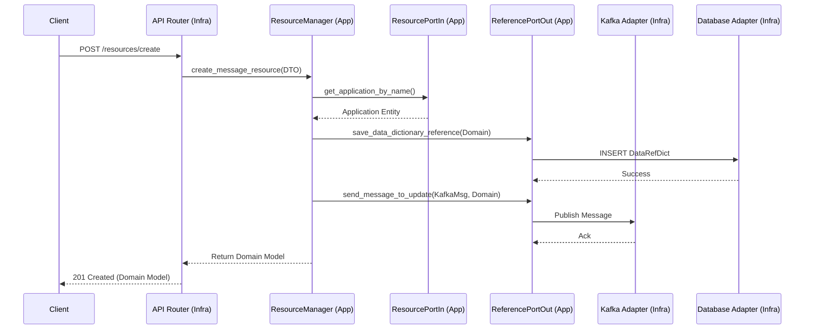

# Project Review: Resources Orchestrator

## 1. Overview
The **Resources Orchestrator** is a specialized service designed to manage and orchestrate resources used in **Retrieval-Augmented Generation (RAG)** workflows. Its primary purpose is to provide a centralized API to create, update, and review various types of data resources (Message queues, Database schemas, or REST endpoints). 

Once a resource is registered or updated, the system notifies other microservices and Model Context Protocols (MCPs) asynchronously via **Kafka**, ensuring that the orchestration of knowledge/context across the ecosystem remains synchronized.

## 2. Technologies & Design Patterns

### Technologies
*   **Language:** Python 3.14 (as per environment).
*   **Framework:** [FastAPI](https://fastapi.tiangolo.com/) for the REST API layer.
*   **Asynchronous Communication:** [Kafka-python](https://github.com/dpereira/kafka-python) for event-driven updates.
*   **Persistence:** PostgreSQL (managed via SQLAlchemy/Repository pattern).
*   **Data Validation:** [Pydantic](https://docs.pydantic.dev/) for Domain Models, DTOs, and API schemas.
*   **Dependency Management:** [UV](https://github.com/astral-sh/uv) for project and environment management.
*   **Testing:** [Testcontainers](https://testcontainers.com/) for integration testing with real Dockerized instances of Kafka and PostgreSQL.

### Design Patterns & Architecture
*   **Hexagonal Architecture (Ports and Adapters):** The project strictly separates the **Domain** (core logic) from **Infrastructure** (external tools) and **Application** (orchestration).
    *   **Domain:** Pure business logic, entities, and definitions.
    *   **Application:** Use cases (Services) that orchestrate domain logic using defined **Ports**.
    *   **Infrastructure:** Concrete implementations of ports (Adapters) for DB, Messaging, and Web.
*   **Dependency Injection (DI):** Heavy use of FastAPI's `Depends` and manual injection in the application layer to facilitate decoupling and testing.
*   **Repository Pattern:** Used in the persistence layer to abstract database operations from the application logic.
*   **Adapter Pattern:** Implemented to translate between different protocols (e.g., HTTP to Application Service, or Kafka messages to Domain events).
*   **DTO (Data Transfer Object):** Used to decouple the API contract from the internal Domain Models, preventing leaking of infrastructure details.

## 3. Project Structure

```text
.
├── pyproject.toml          # Project metadata and dependencies
├── uv.lock                 # Locked dependency versions
├── src/
│   ├── main.py             # Application entry point (FastAPI Lifespan/Startup)
│   └── resources_orchester/
│       ├── application/     # Orchestration Layer
│       │   ├── adapters/    # Bridge between App and Infra (e.g., Service injection)
│       │   ├── ports/       # Interfaces for Inbound/Outbound communication
│       │   └── resource_services/ # Use Case implementations (e.g., ResourceManager)
│       ├── domain/          # Core Business Layer
│       │   ├── api_dtos/    # Data Transfer Objects for API communication
│       │   ├── enum/        # Domain-specific enumerations
│       │   ├── exception/   # Domain-specific exceptions
│       │   └── model/       # Core Business Entities (Pydantic)
│       └── infrastructure/  # Implementation Layer
│           ├── api_router/  # REST Controller (FastAPI Routers)
│           ├── messaging/    # Kafka Adapters and Workers
│           └── persistence/  # Database Adapters, Entities, and Repositories
└── test/
    ├── application/        # Unit & Integration tests for Use Cases
    └── infraestructure/     # Integration tests using Testcontainers (Real DB/Kafka)
```

## 4. Detailed Block Analysis

### 4.1. Domain Layer
The heart of the system. It contains the pure business rules and entities. It has no dependencies on any external library other than Pydantic for validation.

**Main Entities:**
*   **`DataResources`**: Represents a collection of data fields and their metadata.
*   **`ContextResource`**: Represents structured context (e.g., from Markdown files).
*   **`DataFieldResource`**: Granular metadata for a specific attribute (name, type, description, validations).

### 4.2. Application Layer
Contains the **Use Cases** (Services). It defines **Ports** (Interfaces) that the domain requires to complete a task.

**Core Logic (Sequence Diagram):**
The following diagram describes the flow of the `create_message_resource` use case:



### 4.3. Infrastructure Layer
Handles all external communications.
*   **API Router:** The REST controller. It receives HTTP requests, validates them via DTOs, and calls the Application Service.
*   **Messaging:** A Kafka-based implementation. It includes workers to consume updates and producers to notify the rest of the system.
*   **Persistence:** An implementation of the Repository pattern for PostgreSQL, mapping Domain models to Database Entities.

### 4.4. Testing Strategy
The project follows a "Real Integration" approach:
*   Instead of mocking the Database or Kafka, the `test/infraestructure` suite uses **Testcontainers**.
*   This ensures that the actual SQL queries and Kafka topic interactions are validated against real running instances, significantly reducing "it works in tests but not in prod" issues.
```